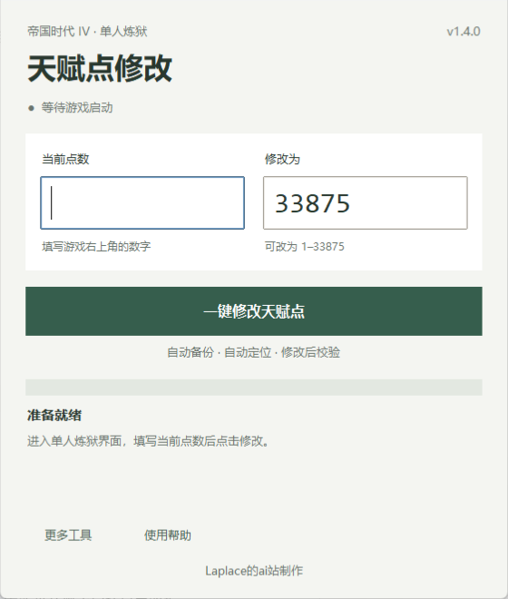

# 帝国时代4 · 炼狱天赋点修改

**Laplace的ai站制作**

用于《帝国时代4》单人炼狱 / PVE 场景的 Windows 天赋点工具。填写当前点数，点击一次按钮，自动备份、定位、写入并回读校验。



## 下载

在 [Releases](https://github.com/yongqixue99-hue/aoe4-talent-tool/releases/latest) 下载免安装 ZIP，解压后运行“帝国时代4天赋点修改器.exe”。无需安装 Python。

当前版本：**v1.4.0**。适用于 Windows x64。此项目为非官方工具，仅用于单人场景。

## 使用

1. 启动游戏，进入单人炼狱界面。
2. 填写游戏右上角显示的当前天赋点数。目标默认 33875，也可以自行修改。
3. 点击“一键修改天赋点”，或在主界面输入框按回车。
4. 显示成功后，回到游戏，将“已启用天赋”关闭再打开一次，刷新并保存。

当前点数需要手动填写。扫描期间可以按 Esc 取消。备份恢复、手动筛选、诊断信息位于“更多工具”。完整步骤见 [使用说明](使用说明.txt)。

## v1.4.0 更新

- 主界面、帮助、诊断和 EXE 属性加入“Laplace的ai站制作”。
- 新增使用帮助和键盘操作，输入有误时自动选中相应字段。
- 游戏版本只在进程变化时重新读取，减少后台重复读取。
- 一键写入成功后清除旧扫描结果，避免误用过期状态。

## 备份与恢复

写入前自动备份 `rogue_mode.rlc`。备份保存于 `%LOCALAPPDATA%\AoE4_RogueTalentTool\backups`，附带 SHA256 清单。

恢复时先退出游戏，再在“更多工具”中选择“恢复最近备份”。程序会先保留当前存档，再校验并恢复备份。备份缺失、损坏或游戏仍运行时会给出提示。

游戏更新可能改变内存布局。本工具保留候选数量限制、写前旧值验证、写后回读和失败回滚；未验证通过时不会使用普通匹配地址替代。自动测试不代表所有游戏版本都经过实机验证。

## 开发与打包

Windows、Python 3.10+；运行源码仅需要 Python 标准库（含 Tkinter）。

```powershell
python -m unittest discover -s tests -v
python AoE4_RogueTalentTool.py --self-test
python AoE4_RogueTalentTool.py --smoke-test
python -m pip install -r requirements-dev.txt
powershell -NoProfile -ExecutionPolicy Bypass -File .\build_release.ps1
```

打包脚本先执行测试，再生成 EXE，随后执行 EXE 自检和界面启动检查。二进制发布包附带 `SHA256SUMS.txt`。源代码仓库不包含游戏存档、个人备份或构建缓存。
